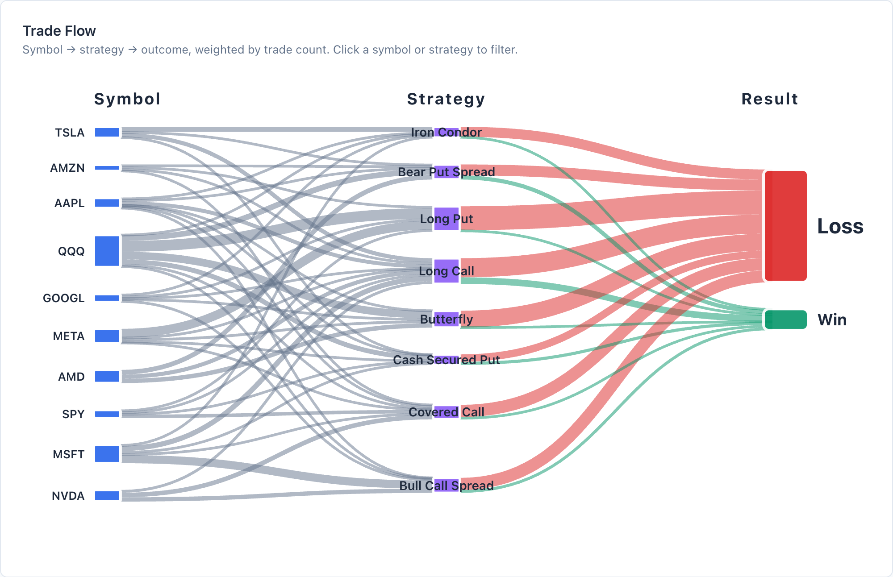

# Option Insights

A personal options trading dashboard that turns a broker CSV export into a report on
what worked, what didn't, and why.

Your trades. Your browser. Your insights. No tracking or cookies.

**[Try it](https://psumiya.github.io/option-insights/)** · **[Documentation](https://psumiya.github.io/option-insights/docs/)**



## Quick Start

Open the app and click **Demo** to explore 100 sample trades, or **Upload CSV** to load
your own export. Robinhood and TastyTrade formats are detected automatically, and a
generic CSV with basic trade columns also works. See
[Broker Support](docs/BROKER_SUPPORT.md) for the formats.

The app has five views. **Report** walks through your P/L by symbol, strategy, timing
and outcome, and clicking any chart filters the whole app. **Research** checks whether a
pattern is an edge or luck. **SPX 0DTE** lines up your same-day SPX trades against how
far SPX moved that day. **Trades** lists the reconstructed trades behind every chart.
**Ask Claude** copies a summary of your trades for you to paste into Claude. The
[documentation](https://psumiya.github.io/option-insights/docs/) covers each view, the
filters and how P/L is calculated.

## SPX 0DTE

This view needs a TastyTrade transactions export. It picks out SPX option positions
opened on their expiration day (Eastern time), matches closes to opens first in, first
out, and names each structure from its legs. Each position is then measured against
that day's SPX bar:

- the day's move, open to close or prior close to close, bucketed from under 0.3% to over 1.5% in each direction
- how far the short strikes sat from the open, whether the day's range reached them, and whether they finished in the money
- entries before 11:00 ET against later ones

The day explorer draws each day's range against your strikes and shows VIX open and
close. Structure and outcome filters take several values at once, and tapping a row in
either table filters the rest of the view.

Daily SPX and VIX bars come from Yahoo Finance and are cached in `data/` as JSON. A
scheduled job in the Pages workflow runs `scripts/fetch-bars.mjs` each weekday after the
close, checks the bars against the NYSE calendar, and commits any new days. A banner in
the view says when the cached data is behind.

## Privacy

Everything runs in your browser. Your CSV is never uploaded, data is kept in
localStorage, and there are no analytics calls. The only network requests are for the
site's own cached SPX and VIX files. Ask Claude only copies text to your clipboard; it
reaches Anthropic only if you paste it yourself.

## Local Development

```bash
python3 -m http.server 8000
```

Then open http://localhost:8000. Tests run on Node 18 or later with no install:

```bash
node --test tests/*.test.js
```

See [TESTING.md](docs/TESTING.md) for the older browser test pages. To refresh the market
data by hand, run `node scripts/fetch-bars.mjs`, or add `--backfill` to refetch everything
from 2025-01-02.

## License

See [LICENSE](LICENSE).
